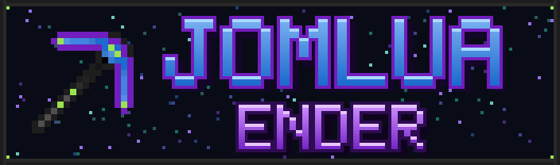

<p align="center">
  
</p>

<p align="center">
  <b>Technology from the End</b> – Endarium gear, upgradeable armor, machines, uranium processing and a multiblock nuclear reactor.
</p>

<p align="center">
  
  
  
  
</p>

---

> ⚠️ **Alpha:** Jomlua Ender is in active development. Expect changes and back up your worlds.

## ✨ Features

### Materials
| Material | Where | Used for |
|---|---|---|
| **Germanium** | Overworld, Deepslate, Nether and End ores | Machines and components |
| **Endarium** | End ore | Endarium tools, weapons and armor |
| **Galaxis Quartz** | Budding Galaxis clusters | Arc Fusion recipes |
| **Uranium** | Deepslate layer only | Reactor fuel – *radioactive when held!* |

Ores, ingots, dusts and storage blocks use the common `c:` tags, so other mods (crushers, pulverizers, ...) can process them.

### Endarium Gear
The tier above Netherite. Every piece is **unbreakable** and fire resistant.

- **Pickaxe, Axe, Shovel, Hoe** – Smithing Table: Endarium Smithing Template + Netherite tool + Block of Endarium
- **Endarium Sword** – 50 attack damage. Smithing Table: Template + Netherite Sword + Endarium Sword Shard
- **Smithing Template** – found only in End City treasure chests
- **Weapon Scrap** – 50 % drop chance from the Wither, fused into the Sword Shard in the Arc Fusion Chamber

### Upgradeable Endarium Armor
Upgrade armor at the Smithing Table with an **empty template slot**:

| Piece | Item | Upgrade | Stacks |
|---|---|---|---|
| Helmet | Golden Carrot | Night Vision | once |
| Helmet | Heart of the Sea | Water Breathing | once |
| Chestplate | Nether Star | Creative Flight | once |
| Legs | Magma Cream | Fire Immunity | once |
| Legs | 16 × Sugar | +15 % Speed | up to 3× |
| Boots | Phantom Membrane | No Fall Damage | once |
| Boots | Rabbit's Foot | Higher Jumps | up to 3× |
| **All pieces** | 10 × Endarium Ingot | +1 Heart | up to 10× |

### Machines
- **Coal Generator** – burns coal into FE
- **Electric Smelter** – all furnace recipes, powered by FE
- **Arc Fusion Chamber** – fuses two items with energy into something new (data-driven JSON recipes)
- **Germanium Miner** – multiblock miner
- **Speed & Efficiency Upgrades** – stack up to 8 per machine
- **Side Configuration** – choose input/output for every side; outputs push automatically (works great with AE2)

### ☢️ Nuclear Reactor (Multiblock)
Build a hollow box from **3×3×3 up to 7×7×7** – every side can have its own length.

- **Edges & corners:** Reactor Casing
- **Walls:** Reactor Casing, Reactor Glass, Reactor Ports and exactly one Reactor Controller
- **Inside:** empty – the bigger the inside, the more power

| Size | Output | Cooling water |
|---|---|---|
| 3×3×3 | 100 FE/t | 80 mB/s |
| 5×5×5 | 2,700 FE/t | 2.2 buckets/s |
| 7×7×7 | 12,500 FE/t | 10 buckets/s |

Uranium Ingots are burned into energy (200,000 FE each) and Nuclear Waste. Without water the reactor heats up and shuts down at 1000 °C.
**Reactor Ports** switch between *Input* (uranium + water), *Energy* and *Waste* with a right-click.
Once formed, the whole structure merges into one seamless machine – and through Reactor Glass you can watch the cooling water rise.

### Utility
- **Infinite Water Source** – unlimited water on every side, no transfer limit, works with pipes from any mod
- **Reactor Glass** – connected glass, also perfect for windows in your base

## 🔌 Compatibility
- **JEI** – recipe pages for the Arc Fusion Chamber, Electric Smelter, Armor Upgrades and Mob Drops, plus a reactor building guide
- **NeoForge Transfer API** – items, fluids and energy work with Mekanism, EnderIO, AE2 and other tech mods
- **Common tags** (`c:ores/uranium`, `c:ingots/uranium`, ...)

## 🛠️ Building from source
Requirements: **JDK 25**

```bash
git clone https://github.com/Prasodym/JomEnder.git
cd JomEnder
./gradlew build        # the mod jar ends up in build/libs/
./gradlew runClient    # start a test client
```

> **Note:** JEI is currently referenced as a local file. Place `jei-26.1.2-neoforge-29.43.0.107.jar` in `run/mods/` before building.

## 📜 License
The code and original assets of Jomlua Ender are licensed under the [MIT License](LICENSE).

Some textures (e.g. the Endarium armor and the Infinite Water Source) are derived from Minecraft assets © Mojang Studios and are **not** covered by the MIT License.

*Not an official Minecraft product. Not approved by or associated with Mojang or Microsoft.*
